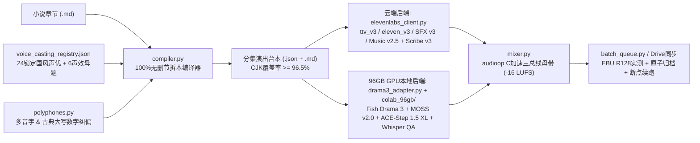

# aigc-audio-pipeline (v1.1.0)

工业级中文广播剧 / 电影感多人精品有声剧全链路生产流水线（支持 **ElevenLabs v3 云端五合一** 与 **Colab 96GB G4 本地开源三件套 `Fish Audio Drama 3 + MOSS-SoundEffect v2.0 + ACE-Step 1.5 XL`** 双后端）：**原生国风捏声定角 → 100% 无删节多角色拆本编译（含修仙多音字纠偏） → 双后端对白/动效/配乐合成与 ASR 质检 → 自然语速三总线闪避母带合成 → 单集原子云端归档与断点续跑**。

> 大体积音频母带（`.wav` / `.mp3`）、打包资产包（`.zip`）与密钥不进 Git；台本、声线圣经、进度台账与完整流水线代码全量入库管理。
>
> - 方法论手册：[`playbook/AUDIO_RADIO_DRAMA.md`](playbook/AUDIO_RADIO_DRAMA.md)
> - 十三项核心优化点与实战复盘：[`docs/OPTIMIZATIONS.md`](docs/OPTIMIZATIONS.md)
> - Colab 96GB 本地满血开源三件套推理套件：[`colab_96gb/README_Colab_96GB_Drama3.md`](colab_96gb/README_Colab_96GB_Drama3.md)
> - 连载实战工程包（《诸界锁仙》第 01–40 章）：[`projects/zhujie_suoxian/`](projects/zhujie_suoxian/)

---

## 一、 全链路双后端架构（核心库零第三方 Python 依赖 + `ffmpeg`）



### 核心模块职责

| 模块 | 核心职责与关键能力 |
| :--- | :--- |
| [`models.py`](src/aigc_audio_pipeline/models.py) | 强约束校验 `eleven_v3` 三档离散稳定性（`0.0 / 0.5 / 1.0`）、拦截 SSML 与中文标签误用；支持 `text`（文学正字）与 `tts_text`（同音注音）双轨分离；管理跨百章持久化 `VoiceCastingRegistry`、`sonic_motifs` 与追加式 `_v001` 版本命名 |
| [`polyphones.py`](src/aigc_audio_pipeline/polyphones.py) | 中文古风/仙侠高频多音字（`引气一重..九重`、`真传`、`忝为`、`降生/降临`、`九月廿三`、`白芨`、`虫豸`、`龟裂`、`辟谷`、`三更` 等）及账册古典大写数字（`壹号..拾号`、`第柒拾叁号`）自动同音纠偏，保证发音精准且 `.srt` 字幕正字零污染 |
| [`adapter.py`](src/aigc_audio_pipeline/adapter.py) | 上下文感知的 `is_spoken_dialogue_quote()`（精准过滤功法名/专有名词引号，防角色串音）、自动剥离对白前冗余 `“某某道：”` 提示语并导出导演可读版 Markdown 台本 |
| [`compiler.py`](src/aigc_audio_pipeline/compiler.py) | 100% 无删节小说转多角色分幕台本编译器：1 对 1 台词对位校验 + `match` 子串防漂移断言、相邻旁白智能合并、高燃/悬疑旁白自动情绪分级（`[dramatically]` + `0.0`）、**`>= 96.5%` 原著汉字覆盖率硬门禁** |
| [`elevenlabs_client.py`](src/aigc_audio_pipeline/elevenlabs_client.py) | 单密钥（兼容 Scoped Key）打通五合一接口：原生国风捏声（`eleven_ttv_v3`）、对白（`eleven_v3`）、动效（`eleven_text_to_sound_v3`）、纯配乐（`music_v2_5`，防 `seed` 422 冲突）、转写（`scribe_v3`）；内置 `cmn-CN` 防洋腔二次过滤、SHA-256 全链路缓存、6 次抖动指数退避重试与 `quota_exceeded` 快速熔断 |
| [`drama3_adapter.py`](src/aigc_audio_pipeline/drama3_adapter.py) | **Fish Audio Drama 3 戏剧转译与声纹锚点适配器**：将 `eleven_v3` 台本自动转译为 Drama 3 原生自然语言舞台指示词（`[cold, deadly calm, suppressed fury]`）、XML 韵律跨度（`<whisper>`/`<forceful>`/`<slow>`）及可选 `<\|phoneme_start\|>` 拼音钉死；内置首尾死寂静音精裁与 `44.1kHz -16 LUFS` 零样本干声锚点打包器 |
| [`qa.py`](src/aigc_audio_pipeline/qa.py) | Scribe v3 / `faster-whisper` 双参考质检：自动检测英文方括号标签漏读、句尾截断漏字、静音与削波；首轮异常自动简化标签重试，止损保质 |
| [`mixer.py`](src/aigc_audio_pipeline/mixer.py) | `48kHz` 采样级三总线母带混音（`audioop` C 扩展秒级加速）：**Bus A 人声**（支持 `dry` / `mental_realm` 识海混响 / `memory_echo` 记忆回声）、**Bus B 前景动效**（绝不随人声压矮）、**Bus C 分幕配乐**（对白闪避至 `0.11`、气口回升至 `0.34`），支持自定义 `stem_prefix`（如 `E001_drama3_master_v001` 防覆盖云端版）与 `320k` MP3 导出 |
| [`batch_queue.py`](src/aigc_audio_pipeline/batch_queue.py) | 多集弹性排产队列与断点恢复器：默认 `--workers 4`（严守 5 并发上限）、FFmpeg `ebur128` 实测响度/真峰值、Google Drive 多线程归档与 `production_progress_ledger.json` 单集级检查点 |
| [`colab_96gb/`](colab_96gb/) | **96GB G4 GPU 本地三模常驻推理套件**：同卡常驻 `fishaudio/drama-3`（SGLang-Omni + RAS 参考采样）+ `MOSS-SoundEffect v2.0` + `ACE-Step 1.5 XL Turbo` + CPU `int8 faster-whisper` 零显存质检，零 API 边际成本批量产出电影感母带 |

---

## 二、 快速上手（CLI 全命令指南）

```bash
# 1. 环境与密钥自检（支持 ELEVENLABS_API_KEY 环境变量或 ~/.gemini/config/aigc_audio.env）
PYTHONPATH=src python3 -m aigc_audio_pipeline check-env

# 2. 提取小说章节全部真实开口台词编号（辅助快速编写导演分幕蓝图）
PYTHONPATH=src python3 -m aigc_audio_pipeline extract-quotes \
  --chapter path/to/第01章.md

# 3. 离线校验声线表与单集台本（零 API 消耗）
PYTHONPATH=src python3 -m aigc_audio_pipeline validate \
  --registry templates/voice_casting_registry.example.json \
  --cue-sheet templates/episode_cue_sheet.example.json

# 4. 离线合成波形演练（零成本验证三总线闪避混音与中文角色名 SRT 字幕对齐）
PYTHONPATH=src python3 -m aigc_audio_pipeline synth-dry-test \
  --registry templates/voice_casting_registry.example.json \
  --cue-sheet templates/episode_cue_sheet.example.json \
  --output-dir /tmp/audio_dry_test

# 5. 从零捏造纯正大陆普通话专属国风声线（eleven_ttv_v3）并锁定入库
PYTHONPATH=src python3 -m aigc_audio_pipeline voices design \
  --description "一位六十五岁的中国北方老管家，纯正标准中国大陆普通话，嗓音苍老沙哑却透着温厚忠心，绝无外国口音。" \
  --sample-text "少主撑住！外头秋雨寒重，您丹田刚受了反噬，老奴这就去西街敲李郎中的门，拿亡妻这支簪子换半粒护心丸，哪怕拼了这把老骨头，老奴也绝不叫少主死在这冷堂里！" \
  --output-dir /tmp/voice_design_fubo --prefix fubo_old_butler

PYTHONPATH=src python3 -m aigc_audio_pipeline voices create-designed \
  --generated-voice-id <CHOSEN_GENERATED_VOICE_ID> \
  --name "诸界锁仙_福伯_苍桑忠仆" \
  --description "65岁中国北方老管家，沧桑沙哑温厚忠仆声线" \
  --registry path/to/voice_casting_registry.json --role fu_bo --lock

# 6. 关键句试听（含 Scribe v3 质检） → 整集三总线母带渲染
PYTHONPATH=src python3 -m aigc_audio_pipeline audition \
  --registry path/to/voice_casting_registry.json \
  --cue-sheet path/to/e001_audition.json \
  --output-dir path/to/01_声线试听小样

PYTHONPATH=src python3 -m aigc_audio_pipeline render-episode \
  --registry path/to/voice_casting_registry.json \
  --cue-sheet path/to/e001_cue_sheet.json \
  --output-dir path/to/03_分集成片音频 \
  --motifs-dir path/to/04_跨集复用声效与配乐母题 \
  --workers 4 --clean-work-dir

# 7. 长篇连载多集弹性排产与断点续跑（自动跳过已归档集数 + EBU R128 响度校验）
PYTHONPATH=src python3 -m aigc_audio_pipeline run-queue \
  --workspace /shared/user/.gemini/config/zhujie_suoxian_audio \
  --from-ep 7 --to-ep 40 --workers 4

# 8. 预览台本转译为 Fish Audio Drama 3 原生舞台指示与 XML 韵律跨度（零成本检查）
PYTHONPATH=src python3 -m aigc_audio_pipeline preview-drama3 \
  --registry projects/zhujie_suoxian/00_声音选角档案与进度台账/voice_casting_registry.json \
  --cue-sheet projects/zhujie_suoxian/02_分集广播剧台本/E001_第01章_秋雨退婚夜碎丹田_完整有声剧台本.json \
  --limit 8
```

---

## 三、 Colab 96GB G4 本地开源三件套后端（零 API 边际成本）

针对百章级长篇有声剧的高频重混与大批量排产，[`colab_96gb/`](colab_96gb/) 提供单张 **96GB NVIDIA RTX PRO 6000 Blackwell (G4)** 三模常驻流水线，以 **`eleven_ttv_v3` 纯正国风声优干声为声纹锚点**，彻底解决早期纯开源流水线声线干瘪、方括号误读与混音杂乱问题：

- **对白主引擎**：`fishaudio/drama-3`（SGLang-Omni `sm_120` 预编译环境缓存秒启 + `reference_sampling=true` / `RAS` 防复读采样 + 原生英文多子句表演指令 + `<whisper>`/`<forceful>`/`<slow>` 韵律跨度）
- **前景动效引擎**：`OpenMOSS-Team/MOSS-SoundEffect-v2.0`（跨集 `sonic_motifs` 母题直接复用棚录母带）
- **分幕纯配乐引擎**：`ACE-Step/acestep-v15-xl-turbo`（`4.0B DiT` 国风器乐床，缓存命中直接复用）
- **零显存本地质检**：CPU `int8 faster-whisper`（自动捕获英文标签外泄、吞字与幻觉复读并降级重试）

```bash
# 本地一键连接 Colab G4 先跑试听小样 + 第 01 章做 A/B 听感对比（输出 *_drama3_master_v001.*，绝不覆盖云端成片）
python3 colab_96gb/launch_g4_zhujie_drama3.py --session audio96 --episodes AUDITION,E001

# 验收通过后，零 API 成本一键批量跑完剩余第 07–40 章
python3 colab_96gb/launch_g4_zhujie_drama3.py --session audio96 --episodes E007-E040 --skip-existing
```

完整部署与 Notebook 交互指南见：[`colab_96gb/README_Colab_96GB_Drama3.md`](colab_96gb/README_Colab_96GB_Drama3.md)。

---

## 四、 单元测试

```bash
PYTHONPATH=src python3 -m unittest discover -s tests -v
```

---

## 五、 与影像流水线协同

影像成片见同级仓库 [aigc-mv-pipeline](https://github.com/riversxiao/aigc-mv-pipeline) 的 [`PIPELINE.md`](https://github.com/riversxiao/aigc-mv-pipeline/blob/master/playbook/PIPELINE.md)。本仓导出的 `48kHz WAV` 母带、毫秒级中文角色 `.srt` 字幕与完整分轨时间轴 `manifest.json` 可直接作为下游 AI 漫剧 / 动态有声剧的精准声音时间轴基准。
