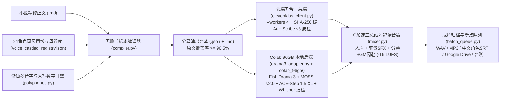

# 中文电影感多人有声剧流水线 · 核心优化点与实战复盘（v1.1.0）

本文档沉淀 [`aigc-audio-pipeline`](../README.md) 从单集验证脚本演进为**长篇连载工业级双后端多人有声剧生产引擎（v1.1.0）**的全部技术优化点、踩坑根因与量化收益。以下机制已在长篇修仙连载《诸界锁仙》（全 40 章无删节多角色台本编译 + 前 6 集共 95 分 15 秒 ElevenLabs 电影感母带交付 + 全 24 角色 Colab 96GB Fish Drama 3 本地推理资产包闭环）中完成端到端实测验证。

---

## 一、 全链路双后端架构全景

---

## 二、 十三项关键工程优化与踩坑解决方案

### 1. 原生国风声优定制（`eleven_ttv_v3`）+ 共享库防洋腔二次清洗
- **痛点**：ElevenLabs 默认共享库即使指定 `language="zh"`，也会混入大量美式、英式、澳洲、新加坡或港台腔多语种自动配音声线（甚至 `locale=cmn-CN` 的老年声线里仍夹杂 `older British` 描述的洋腔声优），且部分用户上传克隆声存在空调底噪，演古风仙侠极易出戏。
- **优化方案**（[`elevenlabs_client.py`](../src/aigc_audio_pipeline/elevenlabs_client.py)）：
  1. 封装 `POST /v1/text-to-voice/design`（`model_id="eleven_ttv_v3"`），支持直接用中文人设描述 + 120–200 字本剧高张力台词从零捏造纯正中国大陆影视剧质感声优（一次出 3 条候选，人工耳审挑中后固化永久 `voice_id`）。
  2. 对共享库检索强制标准化 `locale="cmn-CN"`（避免传 `zh-CN` 触发 `HTTP 400`），并基于 `accent` 与 `description` 做二次黑名单清洗，剔除英美澳新及港台口音。
  3. 强制校检输入长度（`sample_text` 必须 `100–1000` 字符）与加库 `new_name` 参数（防 `HTTP 422`）。
- **实测效果**：《诸界锁仙》24 位锁定声优（20 位原生定制国风声优 + 4 位纯净棚录库声）实现 **100% 纯正大陆戏剧普通话、零底噪、跨百章零串音**。

### 2. 双轨文本架构（`text` 文学正字 vs `tts_text` 发音注音）与修仙多音字/古典大写数字纠偏
- **痛点**：中文古风/仙侠语境存在高频多音字误读（如 `引气一重` 读成 `zhòng` 而非 `chóng`、`真传` 读成 `zhuàn`、`忝为` 读成 `tiān`、`降生/降临` 读成 `xiáng`、`九月廿三` 不识 `廿`、`白芨/虫豸/龟裂/辟谷/三更` 误读），以及古籍账册中大写数字（`第柒拾叁号`、`陆号`、`玖名`）被按姓氏或生僻字误读。若直接改写台本 `text`，又会导致导出的 `.srt` 字幕变成错别字，且触发 ASR 质检误报。
- **优化方案**（[`polyphones.py`](../src/aigc_audio_pipeline/polyphones.py) + [`models.py`](../src/aigc_audio_pipeline/models.py) + [`qa.py`](../src/aigc_audio_pipeline/qa.py)）：
  - 在 `TimelineCue` 中引入双轨字段：`text` 严格保留原著文学正字（用于 `.srt` 字幕渲染与导演台本审阅），`tts_text` 自动经由 `compute_tts_text_override()` 注入同音字替换（如 `引气一重..九重 -> 引气一崇..九崇`、`真传 -> 真船`、`降临 -> 酱临`、`九月廿三 -> 九月念三`、`第柒拾叁号 -> 第七十三号`）。
  - `qa.py` 支持双参考比对（同时对齐 `canonical_prompt` 与 `tagged_prompt`），消除同音替换带来的假阳性重跑。

### 3. 非对白引号精准识别与 100% 无删节拆本编译器（`>= 96.5%` 覆盖率门禁）
- **痛点**：网文正文中常有专有名词、功法名或讽刺强调引号（如 `所谓的“引气篇”`、`“大乾王朝”`、`被唤作“废脉”`）。朴素正则会把它们当成角色开口台词，导致角色分配整体错位；人工手拆长章又容易漏段或缩写。
- **优化方案**（[`adapter.py`](../src/aigc_audio_pipeline/adapter.py) + [`compiler.py`](../src/aigc_audio_pipeline/compiler.py)）：
  - 实现上下文感知的 `is_spoken_dialogue_quote(prev_text, inner_quote, next_text)`，结合引语长度、句末标点、前后修辞词（`所谓/名为/唤作/二字` 等）精准区分「真开口台词」与「行内强调引号」。
  - `compile_episode_cue_sheet()` 强制执行 **1 对 1 台词条数校验 + `match` 子串断言**（防止错位），自动剥离紧邻对白前机械的 `“某某低声道：”` 提示语并转化为行内英文表演标签，最后执行 **`>= 96.5%` 原著汉字覆盖率硬门禁**，从根源杜绝删减原著。

### 4. `eleven_v3` 三档离散稳定性强约束与旁白戏剧分级
- **痛点**：`eleven_v3` 仅支持 `0.0`（Creative）、`0.5`（Natural）、`1.0`（Robust）三档离散值，传中间值（如 `0.35`）会被吸附至 `0.5` 导致表演标签失效；同时若旁白全程用 `0.5` 平铺，遇到碎丹田、开基因锁、古棺震动等无对白高潮段会显得平淡温吞。
- **优化方案**（[`models.py`](../src/aigc_audio_pipeline/models.py) + [`compiler.py`](../src/aigc_audio_pipeline/compiler.py)）：
  - 在模型校验层拦截一切非 `{0.0, 0.5, 1.0}` 的稳定性配置、SSML 标签及中文方括号标签。
  - 编译器根据段落高燃词密度与潜行词自动为旁白分级：高燃战斗/破境自动切 `stability=0.0` + `[dramatically]`，潜行悬疑切 `0.5` + `[softly]`，古碑天音切 `1.0`。

### 5. 三总线自然语速混音、三类空间声场与 `audioop` C 级加速
- **痛点**：传统脚本常把音效与背景音乐混在同一背景轨随人声一起压低，导致雷鸣、拔刀等前景动效变闷；纯 Python 逐采样点计算 15–18 分钟立体声（约 5,000 万采样点）包络耗时极长。
- **优化方案**（[`mixer.py`](../src/aigc_audio_pipeline/mixer.py)）：
  - **三总线物理隔离**：**Bus A（人声主轨）** 按自然语速完整播放绝不裁尾，支持 `dry`（现世干声）、`mental_realm`（识海仙墟空灵混响）与 `memory_echo`（前尘遗言回声）三类声场；**Bus B（前景动效轨）** 独立混入绝不闪避，支持 `sequential`（独立留白顺播）与 `overlay_next`（贴拍同步炸开）；**Bus C（分幕配乐床）** 仅在对白区间平滑压低至 `0.11`，气口与纯动效段回升至 `0.34`。
  - 利用标准库 C 扩展 `audioop` 分块向量化处理包络缩放与立体声叠加，单集 18 分钟母带混音与转码耗时压缩至 **5–8 秒**。

### 6. Scribe v3 双语质检 + 全链路 SHA-256 内容哈希缓存
- **痛点**：`eleven_v3` 偶发将 `[coldly]` 等英文标签直接念出口，或长句末尾吞字；而调优混音参数重跑整集时若重复调 TTS / Music / STT 接口会白白烧掉数万额度。
- **优化方案**（[`qa.py`](../src/aigc_audio_pipeline/qa.py) + [`elevenlabs_client.py`](../src/aigc_audio_pipeline/elevenlabs_client.py)）：
  - 调用 `scribe_v3`（API model `scribe_v2`）开启 `language_code="zh"` + `secondary_language_codes=["en"]`，精准捕获英文标签漏读与句尾漏字；异常时自动简化标签重试一次，满两次即止损。
  - 对 TTS（含 `voice_id`、文本、稳定性）、SFX、Music 以及 **Scribe ASR 转写 JSON（按音频文件 SHA-256 索引）** 全部持久化缓存。二次重混母带或中断恢复时 **API 消耗为 0**。

### 7. 订阅并发上限对齐（`--workers 4`）、抖动指数退避重试与额度耗尽快速熔断
- **痛点**：实测 ElevenLabs 常规订阅并发上限为 **5 个并发请求**——开 `--workers 8` 会密集触发 `HTTP 429 concurrent_limit_exceeded`；反之，当账户总额度耗尽返回 `HTTP 401 quota_exceeded` 时，若盲目重试只会浪费时间。
- **优化方案**（[`elevenlabs_client.py`](../src/aigc_audio_pipeline/elevenlabs_client.py) + [`cli.py`](../src/aigc_audio_pipeline/cli.py)）：
  - 将默认并发工作线程锁定为 `--workers 4`（严格低于 5 并发红线），单集 45–55 轨合成稳定在 **`4.1–4.6 分钟`** 且 **零 429 失败**。
  - 网络层内置 `retries=6` 带随机抖动的指数退避（覆盖 `HTTP 429 / 500 / 502 / 503 / 504` 及瞬时连接断开），同时一旦响应体包含 `"quota_exceeded"` 则 **0 延迟立即熔断抛出**。

### 8. ElevenLabs 接口隐性协议防坑与细粒度 Scoped Key 兼容
- **优化方案**（[`elevenlabs_client.py`](../src/aigc_audio_pipeline/elevenlabs_client.py)）：
  - **`music_v2_5` 禁传 `seed`**：使用 `prompt` 作曲时若同时传 `seed`，官方接口必报 `422 Unprocessable Entity`，客户端已从协议层剔除。
  - **细粒度 Scoped API Key 兼容**：当密钥仅授予生成权限而无 `user_read` 权限（访问 `/v1/user/subscription` 返回 `401/403`）时，`get_subscription_safe()` 自动优雅降级跳过用量查询，不阻断主流程。
  - **采样率自适应无损归一**：非 Pro 档位不支持 `wav_48000` 直出时，自动回退高码率 MP3 并在本地经 FFmpeg 无损解码归一为 `48kHz 16-bit PCM WAV` 上时间轴。

### 9. 跨集声效母题库（`sonic_motifs`）跨百章复用
- **优化方案**（[`models.py`](../src/aigc_audio_pipeline/models.py) + [`batch_queue.py`](../src/aigc_audio_pipeline/batch_queue.py)）：
  - 将全书核心听觉意象（如方寸墟界石门开启、玄霜古棺寒链叩响、第一阶基因锁心跳崩裂等）注册为固定 `motif_id`。首次出场合成后永久落盘并上传云端，后续百章直接零成本加载同一条母带，既省额度又建立鲜明的世界观听觉锚点。

### 10. 追加式版本保护（`_v001` / `_v002`）与云盘挂载文件系统兼容
- **优化方案**（[`models.py`](../src/aigc_audio_pipeline/models.py) + [`batch_queue.py`](../src/aigc_audio_pipeline/batch_queue.py)）：
  - 所有母带、字幕、试听合集均通过 `next_append_only_path()` 自动递增 `_v001`、`_v002` 后缀，严禁覆盖历史版本。
  - 跨 FUSE / 共享卷归档统一使用 `shutil.copyfile()` 替代 `cp` / `shutil.copy2()`，彻底规避共享挂载盘元数据锁导致的跳过报错。

### 11. EBU R128 母带响度实测闭环与中文角色 `.srt` 字幕映射
- **优化方案**（[`batch_queue.py`](../src/aigc_audio_pipeline/batch_queue.py) + [`mixer.py`](../src/aigc_audio_pipeline/mixer.py)）：
  - 每集母带混音完成后自动调用 `ffmpeg ebur128=peak=true` 实测综合响度（稳定在 **`-16.3 ~ -16.4 LUFS`**）与真峰值（True Peak），写入台账与审计日志。
  - `.srt` 字幕自动将内部 `role_id`（如 `lu_jin`）映射为中文角色显示名（`【陆烬】`），并剥离一切英文表演标签，可直接喂入 [`aigc-mv-pipeline`](https://github.com/riversxiao/aigc-mv-pipeline) 做音画精准对齐。

### 12. 单集原子级云端归档与一键断点续跑队列（`run-queue`）
- **优化方案**（[`batch_queue.py`](../src/aigc_audio_pipeline/batch_queue.py)）：
  - `aigc-audio run-queue` 按单集粒度闭环执行「台本同步 → 多线程合成 → Scribe 质检 → 三总线母带 → 响度检测 → Google Drive 四件套并发上传 → 台账刷新」。任意时刻中断或额度用尽，补充额度后重跑同一条命令即可自动跳过已归档集数，零损耗无缝接续。

### 13. 「`eleven_ttv_v3` 国风捏声定角 + Colab 96GB `Fish Drama 3` 本地三模常驻」零边际成本双后端架构
- **痛点**：纯云端 API 在面对百章百万字长篇时存在字符额度成本；而早期纯开源 Colab 方案（直接用通用 TTS 合成参考干声喂给 `Fish Audio Drama 3`）容易出现角色音色扁平、多音字错读、单点情绪标签生硬、句尾拖尾死寂或幻觉复读，听感弱于 `eleven_v3`。
- **优化方案**（[`drama3_adapter.py`](../src/aigc_audio_pipeline/drama3_adapter.py) + [`colab_96gb/run_zhujie_96gb_studio.py`](../colab_96gb/run_zhujie_96gb_studio.py)）：
  1. **高表现力国风声纹锚点移植**：一次用 `eleven_ttv_v3` 捏好全剧 24 位纯正中国大陆戏剧声优，挑出 100% 逐字对齐的无损纯净干声（`10s–30s`），统一校准至 `44.1kHz 16-bit PCM -16 LUFS` 作为 `Fish Drama 3` 的零样本声纹锚点（`voice_cast_drama3.json`），把顶级声优骨相完整迁移到本地 GPU。
  2. **Drama 3 原生戏剧语法适配器**：将 `eleven_v3` 的离散标签自动转译为 Drama 3 最擅长的多子句英文舞台指示（如 `[cold, deadly calm, suppressed fury]`）、角色专属冷笑/轻笑（`[cold laugh]`）及局部 XML 韵律跨度（`<whisper>` / `<forceful>` / `<slow>`），并共享 `polyphones.py` 70+ 项修仙多音字与古典大写数字纠偏（支持可选 `--phoneme-pins` `<|phoneme_start|>` 拼音硬钉）。
  3. **RAS 参考采样 + 零显存 Whisper 质检门禁 + 首尾死寂精裁**：自动探测并开启 SGLang-Omni `--tts_engine.factory.reference_sampling true`（`ras` 回退），配合 CPU `int8 faster-whisper` 检测标签外泄与句尾截断（异常自动简化标签重跑，最多 3 次）及 `trim_edge_silence_wav()` 消除句首句尾拖沓空白。
  4. **单卡 96GB 三模常驻 + 同源三总线 `-16 LUFS` 母带混音**：在 Colab G4 96GB 显存内同时常驻 `fishaudio/drama-3` + `MOSS-SoundEffect v2.0` + `ACE-Step 1.5 XL Turbo`（复用 `AudioStudio_G4_Cache` 预编译包秒级冷启动），跨集 6 枚 `sonic_motifs` 母题直通复用，最终统一汇入 `mixer.py` 输出 `*_drama3_master_v001.{wav,mp3,srt,json}`，实现**零 API 边际成本下的电影级多人有声剧量产**。
